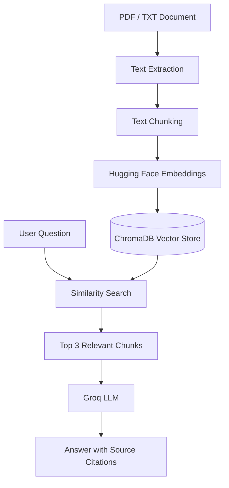
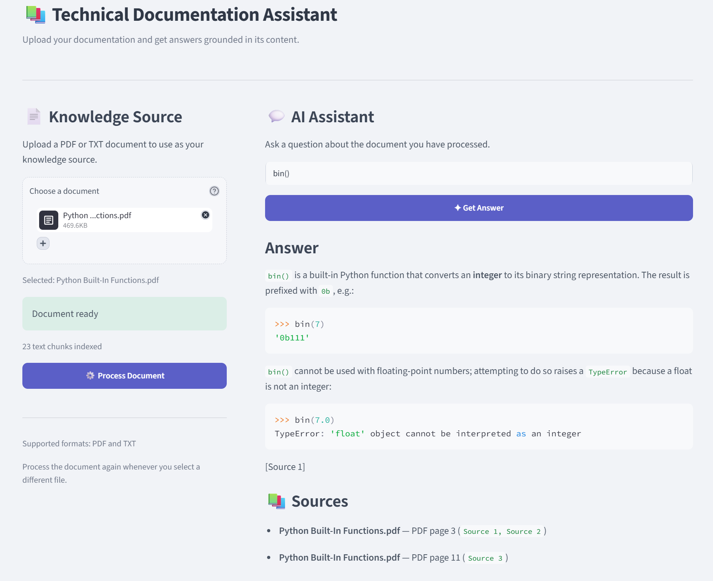

# Technical Documentation Assistant

A Retrieval-Augmented Generation (RAG) application that allows users to upload technical documents and ask questions about their content.

The application retrieves relevant document chunks and uses a Large Language Model (LLM) to generate context-based answers with source citations.

## Features

- Upload PDF and TXT documents.
- Extract and split text into smaller chunks.
- Generate embeddings using Hugging Face.
- Store document chunks in ChromaDB.
- Retrieve relevant chunks using similarity search.
- Generate answers using the Groq LLM.
- Display source citations for retrieved content.

## Technologies Used

- Python
- Streamlit
- LangChain
- Hugging Face Embeddings
- ChromaDB
- Groq API
- PyPDF

## RAG Architecture

The application follows this pipeline:



## How It Works

1. The user uploads a PDF or TXT document, or uses the default sample document.
2. The document text is extracted and split into smaller chunks.
3. Hugging Face generates embeddings for the chunks.
4. ChromaDB stores the embedded chunks for retrieval.
5. When the user asks a question, similarity search retrieves the three most relevant chunks.
6. The Groq LLM generates an answer using the retrieved context.
7. The application displays the answer and available source citations.

## Installation and Setup

### 1. Clone the repository

```bash
git clone YOUR_GITHUB_REPOSITORY_URL
cd Technical-Documentation-Assistant
```

### 2. Create and activate a virtual environment

```bash
python -m venv venv
```

Windows Command Prompt:

```bat
venv\Scripts\activate.bat
```

### 3. Install dependencies

```bash
pip install -r requirements.txt
```

### 4. Configure the API key

Create a `.env` file in the project root:

```env
GROQ_API_KEY=your_groq_api_key
```

Replace the placeholder with your own Groq API key. Do not commit your `.env` file to GitHub.

### 5. Run the application

```bash
python -m streamlit run streamlit_app.py
```

## Project Structure

```text
Technical-Documentation-Assistant/
├── documents/
│   └── rag_notes.txt
├── chroma_db/
├── streamlit_app.py
├── rag_main.py
├── architecture_diagram.png
|── rag_app.png
├── requirements.txt
├── .env
└── README.md
```
## Application Screenshot


## Key Learning Outcomes

- Understanding the Retrieval-Augmented Generation architecture.
- Working with document loading and text chunking.
- Using embeddings and a vector database for semantic retrieval.
- Connecting a language model to retrieved context.
- Building a document question-answering interface with Streamlit.

## Future Improvements

- Improve retrieval quality and evaluation.
- Support OCR for scanned PDFs.
- Add automated tests for document processing and retrieval.


## RAG Architecture


